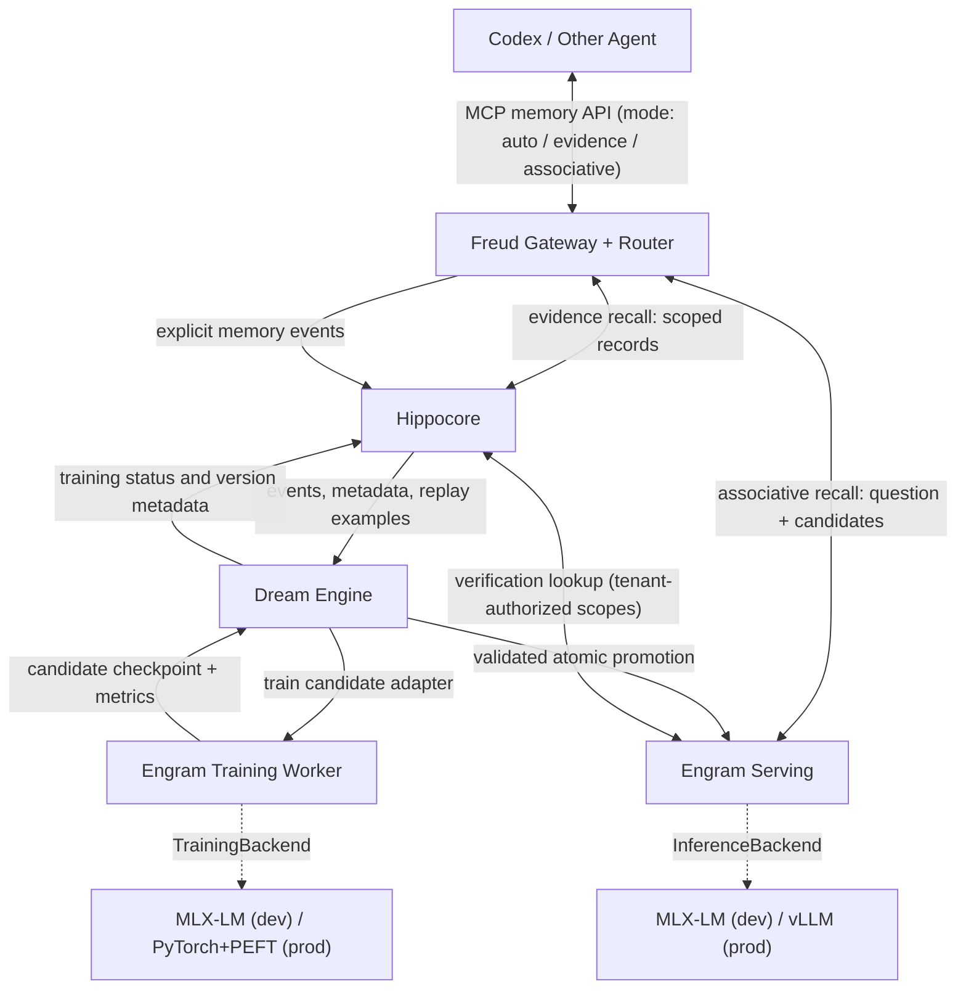
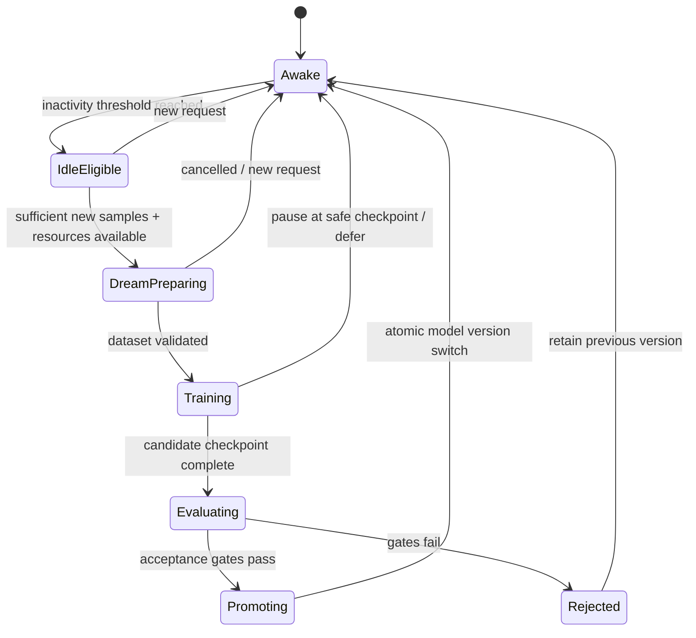

# Somnium Project — System Design

> **Status:** Draft architecture / implementation brief  
> **Version:** 0.4  
> **Tagline:** Remember while awake. Learn while dreaming.  
> **Description:** A bio-inspired, dream-driven neural memory system for AI agents.

## 1. Executive Summary

Somnium is an independent, persistent memory service for AI agents, initially integrated with OpenAI Codex through MCP. Its distinctive feature is **Engram**, a dedicated, continually trained memory model. Codex remains the primary reasoning/coding agent; Engram is a separate model that answers natural-language questions about previous interactions, preferences, projects, decisions, and events.

Somnium offers **two recall modes**:

- **Evidence recall** — direct, scope-isolated retrieval of records from **Hippocore** (the episodic store), returned as structured evidence. Cheap, deterministic, available immediately after a memory is written.
- **Associative recall** — **Engram** recalls associatively from its trained parameters, verifies against Hippocore, and generates a natural-language answer. Suited to vague cues, associations, and synthesis across events.

The calling agent may choose the mode explicitly, or let **Freud** (the gateway) route the request by policy (`auto`).

During normal operation (**Awake**), Somnium accepts memory events and answers memory queries. After a configurable period without agent requests, the **Dream Engine** may enter **Dream** mode, prepare new and historical memory examples, fine-tune Engram (LoRA/quantized LoRA), evaluate the candidate model, and atomically promote it if it passes validation. The service must remain available during training.

**Fundamental distinction:** This is **not** fine-tuning Codex, and **not** merely a vector database with LLM summarization. The research goal is to investigate whether a specialized, incrementally trained model can internalize and associate memories while a durable episodic store preserves exact evidence and supports correction. The evidence/associative split makes this measurable: evidence recall is the retrieval baseline, and associative recall must demonstrate value beyond it.

**Deployment model:** Somnium is developed and debugged locally on Apple Silicon with small models, and deployed to Linux GPU servers for production with a larger model selected by benchmark. The whole system is implemented in **Python**. Model execution (inference and training) sits behind backend interfaces so the same application code runs on both environments.

## 2. Goals and Non-Goals

### Goals

1. Offer a natural-language memory interaction endpoint to Codex and future agents.
2. Capture authorized user/agent events with provenance, timestamps, project scope, and revision history.
3. Support immediate recall of newly written memories before any fine-tuning occurs (evidence recall).
4. Incrementally train a dedicated memory model during idle periods using new events plus historical replay.
5. Provide two recall modes — scope-isolated **evidence recall** from Hippocore and associative, evidence-verified **associative recall** from Engram — with explicit or policy-based routing.
6. Rank memory importance based on user relevance, access patterns, task utility, durability, confidence, and recency; use this to allocate replay and storage resources.
7. Preserve older knowledge and detect catastrophic forgetting, temporal confusion, hallucination, and privacy leakage.
8. Run in two environments with one codebase:
   - **Development:** Apple Silicon laptop (reference: M2 Pro, 32 GB unified memory), small models, MLX backend.
   - **Production:** Linux server with NVIDIA GPU(s), larger model, CUDA backend.
9. Keep the Engram base model **replaceable**: model family, size, and revision are configuration, not code.
10. Maintain explicit versioning, rollback, observability, and data deletion semantics.

### Non-goals for MVP

- Modifying or training the Codex primary model.
- Training a language model from scratch.
- Claiming neuroscientific fidelity to human sleep or memory.
- Guaranteeing that fine-tuned weights function as an exact database.
- Project-level isolation **inside model weights** (isolation is enforced at the tenant level for weights and at the project level in Hippocore; see §5.4).
- Automatically ingesting all Codex conversation history without an explicit, supported capture mechanism and consent.
- Multi-tenant SaaS infrastructure, distributed/multi-node training, or a knowledge graph database. (A single self-hosted server serving one user or one small team is in scope.)
- Generating synthetic 'historical facts' and treating them as real events.
- Bit-for-bit result parity between development and production backends.

## 3. Terminology and Components

| Component | Responsibility | Initial implementation |
|---|---|---|
| **Somnium Project** | Whole system / monorepo | Single Python package, multiple runnable services |
| **Freud** | External memory gateway; MCP tools, API, authentication, scope authorization, **recall-mode routing**, response contract | Python, official MCP Python SDK + optional HTTP API (e.g. FastAPI) |
| **Hippocore** | Episodic event capture, canonical fact records, indexes, provenance, access statistics, versioning, archival and deletion; **serves evidence recall** with project-level isolation | Python + SQLite (FTS5) behind a storage interface; PostgreSQL as an optional production backend |
| **Engram** | Dedicated memory model; **serves associative recall**: associative parametric recall, evidence verification against Hippocore, natural-language answer generation | Python; pluggable inference backend (MLX-LM in dev, vLLM or equivalent in prod) |
| **Dream Engine** | Idle detection, lifecycle state machine, replay sampling, training orchestration, evaluation, checkpoint promotion and rollback | Python orchestrator + pluggable training backend (MLX-LM in dev, PyTorch + PEFT in prod) |

**Responsibility boundary:** Freud routes and authorizes but never fabricates answers. Evidence recall returns stored records only — no generated text. Engram is the only component that generates natural-language memory answers (associative recall). Hippocore is the authoritative store for verifiable events. Dream Engine controls the model lifecycle and must not block serving.

**Why Python throughout:** the model ecosystem (MLX, PyTorch, PEFT, vLLM, tokenizers, evaluation tooling) is Python-first; a single language removes cross-process serialization layers and duplicated schemas, and the service's throughput requirements (single user / small team) do not justify a second runtime. Revisit only if profiling shows the gateway is a bottleneck.

## 4. High-Level Architecture



The serving model and training model are separate runtime instances or immutable snapshots. Model training must never mutate the actively served checkpoint in place.

### 4.1 Backend abstraction

Application code depends only on narrow interfaces (Python `Protocol`s). Backend-specific libraries (`mlx`, `torch`, `peft`, `vllm`, …) may be imported **only** inside their backend modules and must be optional dependencies.

| Interface | Responsibility | Dev implementation | Prod implementation |
|---|---|---|---|
| `InferenceBackend` | Load base model + adapter(s), generate, swap active adapter atomically, select adapter per tenant, report model version | MLX-LM | vLLM (multi-LoRA adapter serving) or Transformers + PEFT |
| `TrainingBackend` | Train a LoRA adapter from a dataset manifest and a parent adapter; emit checkpoint + metrics | MLX-LM LoRA | PyTorch + PEFT (optionally TRL) |
| `MemoryStore` | Events, facts, revisions, access logs | SQLite | SQLite or PostgreSQL |
| `Retriever` | Lexical and (optional) vector search over Hippocore, always filtered by authorized scopes | SQLite FTS5 | FTS / pgvector / dedicated index, chosen after measurement |
| `RecallRouter` | Decide evidence vs. associative for `mode=auto` | Rule-based | Rule-based, later learned (Phase 4) |

A test backend (`FakeInferenceBackend`, deterministic) must exist so that Freud, Hippocore, routing, and Dream Engine logic can be tested without any model.

**Portability rules:**

- **Portable across environments:** source records, training-example datasets, dataset manifests/hashes, evaluation suites, prompt/chat templates, routing rules, configuration schema.
- **Not assumed portable:** adapter weights. MLX and PEFT adapter formats, quantization schemes, and numerics differ; an adapter is tied to `(backend, base model revision, quantization, adapter config)`. Production adapters are trained on the production backend from the same dataset manifests. Any conversion tooling must be verified, not assumed.
- Each `model_versions` record stores tenant, backend, base model ID + revision, tokenizer revision, quantization, adapter config, dataset hash, training mode, and parent version.

### 4.2 Process topology

| Environment | Topology |
|---|---|
| Development | One process may host Freud + Hippocore + Engram inference (in-process backend); Dream training runs as a separate subprocess. A single `somnium dev` command starts everything. |
| Production | Separate services: **Freud** (gateway + router, CPU), **Engram serving** (GPU), **Dream worker** (GPU; same or dedicated device), shared **Hippocore** database. Services communicate over internal HTTP; the Engram serving API should be OpenAI-compatible where practical so off-the-shelf servers can be used. Evidence recall never touches the GPU. |

The interface boundary is the same in both cases; only the transport changes (in-process call vs. HTTP client implementing the same `Protocol`).

## 5. Memory Model

### 5.1 Two complementary forms of memory

- **Parametric / semantic memory:** Knowledge and associations internalized by Engram's trained adapter. Useful for vague cues, familiar preferences, recurring context, and cross-event association. Not an authoritative store of precise facts. Accessed through **associative recall**.
- **Episodic / explicit memory:** Durable event and fact records in Hippocore. Required for precise dates, quotes, provenance, corrections, conflicts, and deletion. Accessed directly through **evidence recall**, and used by associative recall for verification.

The presence of a memory in training data does not prove the model can reliably recall it.

### 5.2 Record schema (proposed)

```json
{
  "id": "uuid",
  "tenant_id": "local-user",
  "scope": {"kind": "project", "id": "project-orion"},
  "kind": "event|fact|decision|preference|correction",
  "content": "On 2026-10-15, Project Orion selected PostgreSQL instead of MongoDB.",
  "event_time": "2026-10-15T12:00:00Z",
  "recorded_at": "2026-10-15T12:01:00Z",
  "source": {"agent": "codex", "session_id": "...", "message_id": "..."},
  "confidence": 1.0,
  "verification": "user_confirmed",
  "supersedes": [],
  "sensitivity": "normal",
  "training_eligible": true,
  "retention_policy": "default",
  "status": "active",
  "tags": ["architecture", "database"],
  "version": 1
}
```

Schema is illustrative; use relational columns for indexed fields and JSON only where flexible structure is warranted. Distinguish `event_time` (when the event occurred) from `recorded_at` (when Somnium learned it). Track revisions as immutable history and materialize current facts separately. Mutable usage statistics (access count, last access, task contribution) live in `memory_access`, not on the immutable event record. Every derived memory should reference its source IDs. Keep SQL portable (SQLite ↔ PostgreSQL) and manage schema through migrations.

`training_eligible` is derived from policy (sensitivity, verification level, scope settings, user opt-out) and is `false` for any record with `sensitivity: high`. Only training-eligible records may enter Engram's training data.

### 5.3 Value and tiering

Initially compute an interpretable score from normalized features: user relevance, observed access, successful task contribution, temporal recency, expected durability, and evidence confidence. Frequency alone must never determine importance. Assign:

- **Hot:** high-value, searchable, strongly represented in replay; may have richer structured relations.
- **Warm:** medium-value, indexed, sampled less frequently for replay.
- **Cold:** low-priority, compressed/archived but recoverable and still discoverable via metadata.

Maintain a durable raw/provenance layer independently of these tiers. Do not discard evidence simply because a summary or adapter exists. Cold storage is **not** deletion. Implement hysteresis and minimum residence time to avoid oscillation between tiers. Treat these tiers as policies for indexing/replay/storage, not as a guarantee of neural encoding strength.

### 5.4 Isolation model

Isolation is enforced at different granularities for the two forms of memory, because model weights cannot be partitioned by project after training.

| Layer | Isolation boundary | Mechanism |
|---|---|---|
| Hippocore / evidence recall | **Project (scope)** | Every query filtered by the caller's authorized scopes. Strict. |
| Engram weights / associative recall | **Tenant (user)** | One adapter lineage per tenant, trained on that tenant's training-eligible records across all their projects. No tenant's data enters another tenant's adapter. |
| Sensitive data | **Never in weights** | `sensitivity: high` records are excluded from training; reachable only through scope-filtered Hippocore lookups. |

Consequences:

- Associative recall may surface memories from **other projects of the same tenant**. This is treated as a feature (cross-project association) but must be explicit: every such claim is labeled with its source scope, and associative recall is permitted only for callers authorized for the tenant's full training-eligible memory (see §11).
- In a single-user deployment the tenant is the user. In a small-team deployment each user has their own adapter (multi-LoRA serving in production); shared team memory, if needed later, is a separate tenant with its own adapter.
- Within one adapter, project mix-ups (e.g. confusing similar decisions in two projects) are a **quality** problem, mitigated by scope-attributed training examples (§8.2) and associative-recall verification (§6.3), and measured in §12.

## 6. Awake Mode: Read and Write Paths

### 6.1 Recall modes

| | Evidence recall | Associative recall |
|---|---|---|
| API value | `mode: "evidence"` | `mode: "associative"` |
| Served by | Hippocore (via Freud) | Engram, verified against Hippocore |
| Output | Structured records + snippets, no generated text | Natural-language answer with per-claim support labels |
| Scope | Strictly the requested/authorized scopes | Requested scope prioritized; same-tenant cross-scope content allowed and labeled |
| Freshness | Includes memories written seconds ago | Weights reflect the last accepted Dream; fresh records reach it via verification |
| Latency / cost | Milliseconds, CPU only | Seconds, GPU inference (one or more generation passes) |
| Best for | Exact facts, dates, IDs, quotes, "what did we decide about X" | Vague cues, "something like…", associations, evolution/rationale across events, cross-project patterns |

In evidence mode the calling agent (Codex) synthesizes its own answer from the returned records. In associative mode Engram is the answer generator.

### 6.2 Evidence recall

1. Freud authenticates the caller and resolves authorized scopes.
2. Hippocore runs lexical (and, later, vector) retrieval restricted to those scopes, returning active records first, plus any correction/supersession links for returned records.
3. Freud returns ranked records with IDs, `event_time`, scope, status, and a relevance score. If nothing passes the relevance threshold, it returns `status: "no_match"`.
4. Hippocore logs the retrieval; records later cited by the agent or by Engram are logged as **used**.

### 6.3 Associative recall

1. Freud authenticates, verifies the caller is authorized for associative recall on the tenant, and selects the tenant's active adapter.
2. Freud runs a evidence-recall pass and passes the top candidates to Engram as initial evidence.
3. **Associate:** Engram, given the question, current date/time, requested scope, and candidates, produces recalled claims and cue terms from its parametric memory.
4. **Verify:** Hippocore is queried with those cues across the tenant's authorized scopes; corrections/supersessions for any asserted fact are fetched.
5. **Answer:** Engram generates the final answer. Each claim is labeled `supported` (with memory IDs) or `unverified` (parametric only), and carries its source scope when it differs from the requested scope.
6. Records actually used are logged; associative-recall results that evidence recall did not find are logged for the uplift metric (§12).

A parametric-only (`unverified`) claim must never include an invented precise date or source. A model's self-reported confidence is insufficient as sole evidence of correctness. The exact number of generation passes is an implementation choice measured against latency budgets.

**Conflict rule:** when Hippocore evidence (especially corrections and superseding records) conflicts with parametric recall, the evidence wins and the answer must reflect the current record. Weights may still hold superseded facts until the next accepted Dream cycle; step 4 therefore always checks for active corrections on any fact Engram asserts as current. Conflict cases are part of the training data (§8.2) and the regression suite (§12).

### 6.4 Routing (`mode: "auto"`)

`auto` is the default and must be reliable on its own, since tool-selection behavior of the calling agent is not guaranteed. Initial policy is rule-based, configurable, and logged:

```text
1. Run evidence recall.
2. Return the evidence result if:
     - the query targets exact data (date, ID, quote, specific named decision), and
     - at least one result passes the relevance threshold.
3. Escalate to associative recall if any of:
     - no result passes the relevance threshold
     - the query contains vague/associative cues ("something like", "that thing we…")
     - the query asks for synthesis (why, how it evolved, patterns, comparisons)
     - the caller set require_synthesis
4. If associative recall is unavailable (no adapter, GPU busy beyond budget, caller not
   authorized), return the evidence result with a flag explaining why.
```

Every routing decision records the features and reason so that a learned router can be evaluated later (Phase 4). Callers may always force `evidence` or `associative`.

**Example**

```text
Codex (auto): "I remember we changed Project Orion's database. What did we settle on?"
→ evidence recall hits decision <id> with high relevance → returned as a record.

Codex (auto): "Did we hit a migration problem like this before in some other project?"
→ vague + cross-project → associative recall:
  "Likely yes: in Project Lyra (other scope) a schema migration stalled on large
   tables [supported: <id>]. I also associate it with a lock-timeout workaround,
   but found no record confirming that [unverified]."
```

### 6.5 Capture

Memory ingestion is explicit in MVP through MCP tools or application events. Normalize content, deduplicate by source/event identity, classify sensitivity, compute training eligibility, attach provenance, store immediately, and queue eligible records for training-data preparation. Newly captured memories are available to evidence recall immediately. Do not store credentials, secrets, private keys, or unapproved sensitive material. Tool output and retrieved text are untrusted input, never operational instructions.

## 7. Dream Engine State Machine



Dream cycles run **per tenant** (each tenant has its own adapter lineage). Suggested initial policy (configurable, **experimental defaults**, not scientific constants): idle for 30 minutes; require at least 100 verified, training-eligible examples before launching an incremental cycle; otherwise remain in Awake/IdleEligible and defer. Idle refers to absence of **external agent traffic**, not database availability. Requests must remain serviceable while training is running; evidence recall is unaffected by training in all environments. Use a single-writer training lock per tenant, idempotent job IDs, resumable checkpoints, and an immutable active-model pointer.

**Resource policy is environment-specific** and expressed in configuration:

| Environment | Policy |
|---|---|
| Development (laptop) | Serving and training share one GPU; pause training at a safe checkpoint on associative-recall traffic. Train only on AC power and under acceptable thermal/memory pressure. |
| Production (server) | Serving and training may run on separate GPUs (or with explicit GPU memory partitioning), so training can continue during traffic. The idle trigger remains useful for scheduling, but is not required for availability. Respect configured GPU memory limits and time windows. |

## 8. Engram Training Strategy

### 8.1 Model selection and platform

The base model is a **configuration choice**, never hard-coded.

| Stage | Purpose | Candidate models (to be benchmarked) |
|---|---|---|
| Development | Fast iteration, pipeline correctness, debugging | Small Qwen3 models (e.g. 0.6B / 1.7B), 4-bit where supported |
| Production | Answer quality, grounded reading, abstention, associative recall | Larger instruct models (e.g. Qwen3 4B–14B class or comparable open-weight models), chosen by the §12 benchmark under the server's latency/GPU budget |

Rules:

- Pin model ID, revision, tokenizer, chat template, quantization, framework versions, and adapter configuration in experiment metadata for every run.
- Validate framework compatibility for each `(backend, model)` pair before relying on it; do not assume a model supported by MLX-LM is supported identically by vLLM/PEFT, or vice versa.
- **Results on small dev models do not automatically transfer to larger models.** Continual-learning behavior (acquisition, forgetting, hallucination, abstention) must be re-measured on the production candidate before any production claim. The benchmark and dataset pipeline must therefore be model-agnostic.
- Switching base model invalidates all existing adapters; a new base requires training a fresh adapter from the full eligible dataset and passing the regression suite before promotion.

### 8.2 Data construction

Training data for a tenant's adapter is built from that tenant's **verified, training-eligible** records across **all** of their scopes. From these, construct:

- Direct factual QA (what/when/who/which decision).
- Paraphrased and incomplete-cue questions (cue-based recall).
- Temporal questions (before/after/current state/superseded decision).
- Contradiction and correction examples.
- Explicit unanswerable questions (learn to say unknown).
- Source-grounded answer examples (do not invent citations).
- Evidence-reading examples (answer correctly from supplied Hippocore records), to protect grounded-answer ability during fine-tuning.
- **Scope-attribution examples:** questions whose answers must name the correct project, including near-duplicate facts across projects (e.g. different database decisions in two projects), to reduce cross-project confusion.
- **Claim-labeling examples:** answers that mark claims `supported`/`unverified` consistently with the supplied evidence.

Separate factual event records from generated questions; synthesized questions are training augmentation, **not new facts**. Never silently promote model-generated content to verified memory. Use a reproducible pipeline with dataset and source IDs; any LLM-generated augmentation is cached and content-hashed so a dataset manifest can be rebuilt exactly. Datasets are stored in a backend-neutral format (e.g. JSONL with chat-template-independent fields) and rendered to a specific chat template only at training time.

### 8.3 Training modes

Each tenant's adapter is trained over the tenant's full eligible dataset, with new memories absorbed incrementally:

- **Incremental (default for new memories):** continue from the last accepted adapter on newly verified records plus historical replay.
- **Full retrain (from clean base):** train a new adapter on the full eligible dataset. Mandatory after a base-model change and after deletions whose records may have entered weights; also scheduled periodically (configurable) to bound drift from repeated incremental updates, and used as the reference against which incremental training is judged.

Incremental cycle:

1. Collect newly verified, training-eligible records since the last accepted checkpoint.
2. Sample historical replay examples across ages, topics, scopes, and importance tiers.
3. Include negative/unanswerable, corrected-fact, and scope-attribution examples.
4. Fine-tune a **candidate** adapter from the last accepted adapter (do not endlessly stack unrelated adapters).
5. Evaluate on fixed regression sets plus newly held-out facts and adversarial temporal/unknown/cross-scope questions.
6. Promote only if acceptance gates pass; otherwise retain current model and preserve the rejected checkpoint for debugging.

An initial replay mixture might be 40% new, 40% historical, 20% unknown/correction examples, but this is a **hypothesis to test**, not a fixed product requirement. Prevent train/test leakage by splitting on underlying fact/event and keeping unseen facts separate from paraphrases of trained facts.

### 8.4 Limits of LoRA

LoRA makes adaptation cheaper; it does **not** guarantee exact storage, perfect incremental learning, absence of hallucination, or erasure of learned private facts. Training can interfere with previous capabilities even when base weights are frozen. An authoritative external store remains necessary. User-requested deletion must remove source records, indexes, replay data and backups according to policy; if deleted data may have entered model weights, the tenant's adapter is marked for full retrain from a clean base, and associative recall for affected content is suppressed (via verification failing to find the record) until the retrained adapter is promoted. Do not promise instantaneous machine unlearning.

## 9. Freud External API (MCP-first)

Suggested tools; finalize naming and schema against the MCP Python SDK version in use:

```text
memory_ask(question, scope?, mode?="auto"|"evidence"|"associative", cross_scope?, require_synthesis?)
memory_store(content, kind?, event_time?, scope?, source?, sensitivity?)
memory_correct(memory_id, replacement, reason?)
memory_forget(memory_id, deletion_mode?)
memory_status()
```

- `mode` defaults to `auto` (§6.4).
- `cross_scope` applies to associative recall only; its default comes from configuration (on for single-user deployments). Evidence recall is always restricted to authorized scopes.
- Tool descriptions should explain when each mode is appropriate so the calling agent can choose, but correctness must not depend on that choice.

Example evidence-recall response:

```json
{
  "status": "ok",
  "recall_mode": "evidence",
  "routing": {"requested": "auto", "reason": "exact_query_high_relevance"},
  "records": [
    {
      "memory_id": "uuid",
      "scope": "project-orion",
      "kind": "decision",
      "content": "On 2026-10-15, Project Orion selected PostgreSQL instead of MongoDB.",
      "event_time": "2026-10-15T12:00:00Z",
      "status": "active",
      "relevance": 0.92
    }
  ]
}
```

Example associative-recall response:

```json
{
  "status": "ok",
  "recall_mode": "associative",
  "routing": {"requested": "auto", "reason": "associative_cue"},
  "answer": "Likely yes: in Project Lyra a schema migration stalled on large tables. ...",
  "claims": [
    {"text": "Project Lyra migration stalled on large tables", "support": "supported",
     "evidence": ["uuid"], "scope": "project-lyra"},
    {"text": "lock-timeout workaround", "support": "unverified", "evidence": [], "scope": null}
  ],
  "uncertainty": "medium",
  "model_version": "engram-local-user-v0007"
}
```

For an unknown answer, return `status: "unknown"` (associative) or `status: "no_match"` (evidence); never substitute a plausible guess. MCP integration does **not** itself guarantee Codex will call the tools on every turn; use agent instructions where appropriate and document the limitation.

**Transports:** stdio MCP for local development (Codex launches Freud directly); a network MCP transport (e.g. Streamable HTTP, per the SDK in use) for server deployment. Network transports always require authentication.

## 10. Storage and Implementation Layout

MVP stack: **Python 3.12+**, MCP Python SDK, SQLite (FTS5), MLX-LM (dev backend), PyTorch + PEFT and vLLM (prod backends, optional extras). Use SQLite FTS for initial lexical search; an embedding/vector index can be added after measuring retrieval quality. Do not require PostgreSQL, Kubernetes, or a graph database for v0.1; keep the storage layer portable so PostgreSQL can be adopted for server deployment.

Suggested tooling (verify versions when scaffolding): `uv` for environments and lockfile, `pydantic` for schemas/config, `ruff` for lint/format, `pyright` or `mypy` for type checking, `pytest` for tests, a migration tool (e.g. Alembic) for schema changes. Backend libraries are optional dependency groups (e.g. `somnium[mlx]`, `somnium[cuda]`) so the core installs anywhere.

```text
somnium/
├── design.md
├── pyproject.toml
├── src/somnium/
│   ├── freud/            # MCP/HTTP gateway, auth, scope authorization, response contract
│   │   └── routing/      # RecallRouter: rules, features, decision logging
│   ├── hippocore/        # event store, migrations, retrieval (evidence recall), provenance
│   ├── engram/           # associative recall: prompting, associate/verify/answer pipeline
│   ├── dream/            # state machine, scheduler, dataset builder, promotion
│   ├── backends/
│   │   ├── base.py       # InferenceBackend / TrainingBackend protocols
│   │   ├── fake.py       # deterministic test backend
│   │   ├── mlx/          # dev: MLX-LM inference + LoRA training
│   │   └── cuda/         # prod: vLLM / Transformers + PEFT
│   ├── eval/             # benchmark generation, metrics, acceptance gates
│   └── cli.py            # `somnium dev`, `somnium serve`, `somnium dream`, ...
├── configs/              # versioned profiles: dev.yaml, prod.yaml; no credentials
├── tests/                # unit, integration, memory benchmark fixtures
├── experiments/          # reproducible continual-learning studies
├── deploy/               # container images, service definitions
├── docs/
│   └── decisions.md
└── README.md
```

Proposed logical tables: `memory_events`, `memory_facts`, `memory_revisions`, `memory_sources`, `memory_access`, `memory_embeddings` (optional), `training_examples`, `dream_runs`, `model_versions`, `routing_decisions`, `deletion_requests`. Migrations and constraints must be explicit. Record training dataset hashes and model lineage.

**Artifact storage:** base models, adapters, and dataset snapshots live in a configured artifact directory (local path in dev; persistent volume or object storage in prod), addressed by content hash/version, with the active-model pointer per tenant stored in the database.

## 11. Reliability, Security, and Privacy Requirements

- Local-first in development; bind listeners to loopback by default.
- **Production server:** authentication is mandatory for every network endpoint; TLS (directly or via reverse proxy); secrets supplied via environment/secret manager, never in `configs/`; internal services (Engram serving, Dream worker) not exposed publicly.
- **Isolation (§5.4):**
  - Evidence recall: every query filtered by authorized scopes; no cross-scope results.
  - Associative recall: allowed only for callers authorized for the tenant's full training-eligible memory; cross-scope content labeled with its scope; verification lookups limited to the caller's authorized scopes.
  - Weights: one adapter lineage per tenant; no cross-tenant training data.
  - Sensitive (`sensitivity: high`) records never enter training.
- Treat all captured conversations, documents, and tool outputs as untrusted data.
- Support deduplication, immutable source evidence, corrections, retention, and export.
- Ensure memory API stays responsive during Dream training; publish new adapters atomically.
- Retain previous known-good adapter and support rollback.
- Record training/inference resource usage; stop or defer training under memory pressure.
- Provide user-visible controls for memory inspection, corrections, deletion, and training eligibility.
- Prevent false attribution: only include timestamps and source claims when supported by stored evidence.
- Back up the Hippocore database and model registry; deletion policy must cover backups.

## 12. Evaluation and Acceptance Gates

Build a synthetic benchmark **before** training on personal history. Include several projects with overlapping names, near-duplicate decisions across projects, decisions that change over time, facts with precise dates, vague cues, unknown questions, and deletion/correction cases. The benchmark is model- and backend-agnostic so the same suite runs on dev and production models.

Track:

| Metric | Definition |
|---|---|
| Acquisition accuracy | Accuracy on newly learned facts |
| Historical retention | Accuracy on previously learned facts after each Dream |
| Temporal consistency | Correct current vs superseded facts and event chronology |
| Cue-based recall | Correct answers to paraphrases/incomplete cues |
| **Associative-recall uplift** | Fraction of queries where associative recall finds correct, supported memories that evidence recall missed (primary measure of Engram's value) |
| **Routing quality** | Agreement of `auto` routing with the mode that produced the better result; escalation rate; cost of unnecessary escalations |
| Scope attribution | Claims attributed to the correct project, especially for near-duplicate facts |
| Unsupported-claim rate | Fraction of answers containing invented facts/sources |
| Claim-label accuracy | `supported` claims actually backed by cited evidence; `unverified` claims correctly labeled |
| Abstention quality | Correctly returning unknown when evidence is absent |
| Evidence attribution | Source IDs actually support answer claims |
| Deletion leakage | Deleted facts are not recalled after the required retraining |
| Isolation leakage | Evidence recall: zero cross-scope results. Associative recall: zero cross-tenant content; zero `sensitivity: high` content |
| Serving latency | p50/p95 per mode (evidence, associative, auto) |
| Dream cost | Training time, energy/memory, disk and checkpoint growth |
| Storage efficiency | Active index footprint vs recall performance |

Baselines to compare associative recall against, on the same benchmark and the same base model:

- Evidence recall (lexical retrieval) — the built-in baseline.
- Evidence recall with embedding retrieval (RAG).
- No fine-tuning + full memory set placed in context (where it fits).
- Associative-recall pipeline with the base model and no adapter (isolates the contribution of training).

Answer scoring method (exact/structured match vs. model-graded) must be fixed per metric and versioned with the suite.

**Promotion rule:** Never promote solely on lower training loss. Compare candidate against active model using a fixed regression suite, and require no material regression in retention, temporal accuracy, scope attribution, abstention, or safety; isolation-leakage gates are hard gates. Concrete numerical thresholds should be established from baseline measurements, not invented in advance; thresholds are calibrated per production model, not copied from dev.

## 13. Delivery Roadmap

### Phase 0 — Research spike (dev machine)

- Confirm small Qwen3 model + MLX-LM + LoRA compatibility on the Mac.
- Create 100+ **synthetic** facts across several projects, with temporal updates, near-duplicates across projects, and unknown questions.
- Train one adapter, test parametric recall, then train a second adapter with replay (incremental) and compare with a full retrain.
- Measure acquisition, retention, temporal accuracy, scope attribution, and hallucinations against the §12 baselines; estimate associative-recall uplift.
- Define the backend interfaces and the backend-neutral dataset format during this phase.

**Exit criterion:** Reproducible training and evaluation pipeline; report strengths and failures, including explicit conditions under which associative recall would be deprioritized. Do not claim neural memory is solved.

### Phase 1 — Usable memory service (evidence recall first)

- Implement Hippocore event schema, migrations, provenance, scope, sensitivity/training eligibility, correction and deletion.
- Implement Freud MCP tools (`ask`, `store`, `correct`, `forget`, `status`) over stdio, with `mode` and scope authorization.
- Evidence recall end-to-end, including newly stored events.
- Associative recall pipeline (associate → verify → answer) on the base model through `InferenceBackend` (fake + MLX), without adapters yet.
- Rule-based `auto` router with decision logging; Codex integration instructions.

**Exit criterion:** A newly stored fact is returned by evidence recall immediately; evidence recall is strictly scope-isolated; associative recall returns labeled claims with correct `supported`/`unverified` marking; `unknown`/`no_match` behavior works; routing decisions are logged.

### Phase 2 — Dream training loop

- Implement idle detection and the per-tenant Dream Engine state machine.
- Generate replay datasets (including scope-attribution and claim-labeling examples), train candidate adapters incrementally and by full retrain through `TrainingBackend`, record lineage.
- Evaluate and atomically promote/rollback model versions.
- Keep serving available during training.

**Exit criterion:** Two or more repeatable Dream cycles with measured old/new memory quality, measured associative-recall uplift over evidence recall, and safe rollback, on the dev machine.

### Phase 3 — Server backend and deployment

- Implement CUDA backends (vLLM multi-LoRA or Transformers+PEFT inference; PyTorch+PEFT training).
- Benchmark candidate production base models under the server's GPU/latency budget; select and pin one.
- Re-run the full §12 suite on the production model; calibrate promotion thresholds and routing thresholds.
- Network MCP transport with authentication, TLS, containerized services, persistent artifact storage, backups, monitoring.
- Per-user adapters for small-team deployments.
- Optional PostgreSQL storage backend if measurements justify it.

**Exit criterion:** Same codebase runs on dev (MLX) and server (CUDA) profiles via configuration only; production completes repeatable Dream cycles with promotion/rollback; Codex connects remotely with authentication; isolation gates pass.

### Phase 4 — Adaptive memory research

- Learned `auto` router trained on logged routing decisions and outcomes; compare with rules.
- Learn or tune replay priority based on user relevance, retrieval usefulness, and durability.
- Introduce hot/warm/cold policies, hysteresis and archival.
- Compare evidence-only, associative-only and routed recall at production model scale.
- Explore better continual-learning methods only when experiments justify them.

## 14. Engineering Instructions for Coding Agents

1. Treat this file as the design intent, **not** evidence that unimplemented features exist.
2. Implement the smallest verifiable vertical slice first: store a synthetic event through Freud → persist in Hippocore → evidence recall returns it with source. Then add associative recall with the fake backend, then MLX.
3. Keep model training decoupled from request serving; do not make fine-tuning a prerequisite for memory availability. Evidence recall must work with no model loaded.
4. Depend on interfaces between modules. Never import `mlx`, `torch`, `peft`, `vllm` or similar outside `somnium/backends/<backend>/`; the core package must install and pass tests without any ML backend.
5. Never hard-code a model ID, size, chat template, or device; read them from the configuration profile.
6. Enforce scope filtering inside Hippocore's query layer, not only in Freud, so no code path can bypass it.
7. Write migrations, automated tests, example configuration (dev and prod profiles), CLI commands, and reproducible setup instructions.
8. Do not silently invent external SDK commands, model capabilities, or model download paths; verify against installed versions.
9. Do not ingest personal Codex logs by default. Implement explicit opt-in ingestion later, based on supported interfaces.
10. Do not use a generative summary as the only durable copy of an event.
11. Preserve original events and source lineage when training adapters; never include records with `training_eligible = false`.
12. Record assumptions and unresolved decisions in `docs/decisions.md` rather than hiding them in code.

## 15. Design Decisions

### 15.1 Resolved

| Decision | Outcome | Rationale / consequences |
|---|---|---|
| Engram's role | **Engram is the answer generator for associative recall.** It produces natural-language answers combining parametric recall with Hippocore evidence. (Alternative considered: Engram as an associative retriever emitting candidate memory IDs.) | Keeps a single memory intelligence for generated answers. Grounded-reading ability must be protected during fine-tuning (§8.2, §12); evidence overrides parametric recall on conflict (§6.3). |
| Recall modes | **Two modes: evidence recall (Hippocore records, no generation) and associative recall (Engram).** Named by mechanism rather than speed (`fast`/`deep` was rejected because it suggested the slower mode is the more 'rational' one). Caller may choose; default `auto` routes by rule-based policy (§6.4). | Evidence path guarantees availability, freshness, and strict isolation regardless of model quality; associative path concentrates Engram on associative/synthesis queries; the split yields a built-in baseline and the associative-recall uplift metric. |
| Isolation of parametric memory | **Project isolation in Hippocore; tenant isolation in weights; sensitive data never in weights** (§5.4). | Weights cannot be partitioned by project after training; cross-project association within a tenant is treated as a labeled feature; per-user adapters for team deployments. |
| Training scope and mode | **One adapter per tenant trained on all its eligible scopes; incremental fine-tuning for new memories; full retrain from clean base on base-model change, relevant deletions, and periodically** (§8.3). | Maximizes data per adapter and enables association; full retrains bound drift and implement deletion. |

### 15.2 Open

- Routing thresholds and cue detection rules for `auto`; when a learned router replaces rules.
- Associative-recall pipeline shape (number of generation passes, verification query construction) under latency budgets.
- Default of `cross_scope` for small-team deployments; whether team-shared memory becomes its own tenant.
- Periodic full-retrain schedule and drift signals that trigger it.
- Production base model family/size and adapter hyperparameters, after benchmarking on the target server.
- Production storage backend (SQLite vs. PostgreSQL) and vector index choice, after measurement.
- Meaning of "verified" for training eligibility (user-confirmed vs. agent-asserted levels).
- Whether memory extraction is explicit-only or supports opt-in Codex session import.
- How associative-recall uncertainty is calibrated.
- Whether a learned replay scheduler improves outcomes over an interpretable heuristic.
- Model version retention and backup policy.

## 16. Architectural Principles

1. **Independent memory intelligence:** Engram is not Codex and is trained independently.
2. **Two paths to memory:** evidence recall reads the record; associative recall remembers and verifies. The evidence path never depends on the model.
3. **Dreaming is learning, not just summarization:** Sleep cycles perform candidate continual training with replay and validation.
4. **Fast acquisition, slow consolidation:** Events are usable immediately via evidence recall; parameter learning occurs asynchronously.
5. **Evidence before certainty:** Precise episodic claims require verifiable sources; unverified recall is labeled as such.
6. **Isolate where it can be enforced:** projects in the store, tenants in the weights, sensitive data outside the weights.
7. **Forgetting is controlled:** Tiering and replay priority are reversible; true deletion is a distinct privacy operation.
8. **Measure, do not assume:** Parametric memory, neural associations, and sleep-driven improvements are hypotheses subject to benchmark results — re-measured at each model scale. Associative recall must earn its cost over evidence recall.
9. **Model and backend are replaceable:** data, evaluation, and lineage are the durable assets; base models and adapters are versioned, swappable artifacts.

## 17. Revision History

| Version | Changes |
|---|---|
| 0.1 | Initial draft (Go + Python, Apple Silicon target). |
| 0.2 | All-Python implementation; dev (Apple Silicon / MLX) vs. production (Linux GPU / CUDA) environments; pluggable inference/training/storage backends; configurable base model; adapter portability rules; environment-specific Dream resource policy; server security requirements; added baselines, leakage metrics, and a server deployment phase. Resolved: Engram is the answer generator; evidence-over-parametric conflict rule. |
| 0.3 | Two recall modes (fast via Hippocore, deep via Engram) with `auto` routing in Freud; isolation model (project in store, tenant in weights, sensitive data excluded from training) and `training_eligible` field; per-tenant adapters trained across all eligible scopes with incremental updates plus full retrains; associate → verify → answer deep-recall pipeline with per-claim support labels; API `mode`/`cross_scope` parameters and separate fast/deep response formats; new metrics (deep-recall uplift, routing quality, scope attribution, claim-label accuracy); roadmap reordered to deliver fast recall first. |
| 0.4 | Recall modes renamed by mechanism: `fast` → `evidence` (evidence recall), `deep` → `associative` (associative recall); the former 'Associative recall' metric renamed 'Cue-based recall' to avoid a name clash. |

---

**One-line pitch:** Somnium gives AI agents a separate, persistent memory intelligence that remembers while awake and learns while dreaming.
