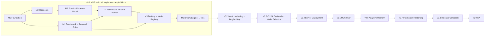

# Somnium — Milestones and Development Plan

> **Status:** Draft plan  
> **Based on:** `design.md` v0.4  
> **Scope:** From an empty repository to the **v0.1 MVP**, then through production-grade iterations to **v1.0**.

---

## 1. Planning Principles

1. **Vertical slices over layers.** Each milestone ends with something runnable end-to-end and testable, not a finished layer waiting for others.
2. **Evidence recall first, learning second.** The service is useful before any model is trained (design §16.2, §16.4). Training never blocks availability.
3. **Benchmark before personal data.** The synthetic benchmark is built early and becomes the regression suite and promotion gate for every later milestone.
4. **Build the MVP on v1.0 seams.** v0.1 runs locally for one user, but every structural decision that would be expensive to change later (tenancy, auth context, API versioning, migrations, backend interfaces, model lineage) is made correctly in v0.1 (see §3).
5. **Measure, then decide.** Open design decisions (design §15.2) are assigned to the milestone that produces the data needed to resolve them (see §8). Thresholds are set from measured baselines, not invented.
6. **Honest exits.** Every milestone has testable exit criteria. Research milestones may end with a negative result; that is a valid outcome and must be recorded.

---

## 2. Release Map

| Release | Theme | Environment | Users |
|---|---|---|---|
| **v0.1** | MVP: evidence recall, associative recall, automatic Dream cycles | Mac (MLX), stdio MCP | 1 |
| v0.2 | Local hardening, real-use dogfooding, observability | Mac | 1 |
| v0.3 | CUDA backends, service split, production model selection | Mac + Linux GPU | 1 |
| v0.4 | Server deployment: network MCP, auth, containers, backups | Linux GPU server | 1 |
| v0.5 | Multi-user: per-user adapters, authorization, quotas | Server | small team |
| v0.6 | Adaptive memory: tiering, replay priority, learned routing | Server | small team |
| v0.7 | Production hardening: security, reliability, upgrades | Server | small team |
| v0.8 | Release candidate: SLOs, docs, operational readiness | Server | small team |
| **v1.0** | General availability for self-hosted single user / small team | Server (+ local dev) | small team |

**Indicative effort** (one developer, full-time equivalent; for sequencing only, not commitments): M0 1 wk · M1 2–3 wk · M2 2 wk · M3 1–2 wk · M4 2–3 wk · M5 2–3 wk · M6 2 wk → **v0.1 ≈ 12–16 weeks**. M1 can run in parallel with M2–M3.

---

## 3. Design for v1.0 from Day One

These are the decisions that are cheap in v0.1 and expensive to retrofit. They are **mandatory in the MVP** even where v0.1 does not strictly need them.

| Concern | What v0.1 must do | Why it matters for v1.0 |
|---|---|---|
| Tenancy | `tenant_id` on every record, run, model version and log row; a single `local-user` tenant in v0.1 | Multi-user (v0.5) without data migration |
| Auth context | Every request carries an `AuthContext` (tenant, principal, authorized scopes, permissions), resolved by a pluggable `AuthProvider`; v0.1 uses a static local provider | Network auth (v0.4) plugs in without touching business logic |
| Scope enforcement | Scope filtering inside Hippocore's query layer; queries without an `AuthContext` are impossible by construction | Isolation guarantees hold for every future code path |
| API contract | Versioned pydantic request/response models with `api_version`; MCP tools are thin adapters over a transport-independent service layer | Adding HTTP/Streamable-HTTP (v0.4) reuses the same contract |
| Schema | Migrations from the first table; **no destructive resets after v0.1**; every release ships forward migrations from all prior releases | Real user data from v0.1 survives to v1.0 |
| Storage portability | SQLAlchemy Core (or equivalent) with portable SQL; SQLite-specific features (FTS5) isolated behind `Retriever` | PostgreSQL option (v0.4) |
| Backend interfaces | `InferenceBackend`, `TrainingBackend`, `Retriever`, `MemoryStore`, `RecallRouter` as `Protocol`s; ML libraries only in `backends/<name>/`, enforced by an import-boundary check in CI | CUDA backends (v0.3) are additive |
| Transport-agnostic calls | Interfaces designed so an HTTP client can implement them (serializable inputs/outputs, no shared in-memory objects) | Service split (v0.3) |
| Model lineage | Content-addressed artifacts; `model_versions` with backend, base model + revision, dataset hash, parent, training mode, tenant | Reproducibility, rollback, deletion-driven retrains |
| Evaluation as gate | The benchmark suite is versioned code; promotion is impossible without a passing gate report | Safe automation at every scale |
| Time | Injectable `Clock` everywhere (idle detection, `recorded_at`, temporal prompts) | Deterministic tests; reproducible experiments |
| Idempotency | Idempotency keys on writes and Dream jobs | Retries over networks (v0.4), crash recovery |
| Config | Typed config with `dev` / `test` / `prod` profiles; secrets only from environment | Server deployment without code changes |
| Observability hooks | Structured logs with request/job IDs from day one; metrics interface (no-op in v0.1) | Production monitoring (v0.2, v0.7) |

---

## 4. Global Definition of Done

Applies to every task in every milestone:

- Code is typed, linted, formatted; CI green on macOS and Linux (core suite runs without ML dependencies).
- Unit tests for logic; integration tests for cross-module behavior; isolation tests for anything touching data access.
- Public interfaces and response models documented (docstrings + `docs/`).
- Schema changes come with a migration and an upgrade test.
- New assumptions or decisions recorded in `docs/decisions.md` (ADR format).
- No model ID, path, threshold, or device hard-coded; everything in config.
- No external SDK behavior assumed without verification against the installed version.

---

## 5. MVP Milestones (v0.1)

### M0 — Project Foundation

**Goal:** A repository where correct code is easy to write and incorrect structure is caught automatically.

**Tasks**

- [x] **M0.1 Repository layout** per design §10 (`src/somnium/{freud,hippocore,engram,dream,backends,eval}`, `configs/`, `tests/`, `experiments/`, `deploy/`, `docs/`).
- [x] **M0.2 Packaging and tooling:** `pyproject.toml`, `uv` lockfile, Python 3.12+, optional extras `somnium[mlx]` and `somnium[cuda]` (empty placeholder for now), `ruff`, `pyright` (or `mypy`), `pytest`, pre-commit hooks.
- [x] **M0.3 CI:** lint, type check, unit tests on macOS and Linux; core install without ML extras; **import-boundary check** (e.g. `import-linter`) forbidding `mlx`, `torch`, `peft`, `vllm` outside `backends/`.
- [x] **M0.4 Configuration system:** typed settings (e.g. `pydantic-settings`), profiles `dev` / `test` / `prod`, environment overrides, `somnium config show` (secrets redacted).
- [x] **M0.5 Core domain types:** `TenantId`, `Scope`, `AuthContext`, `MemoryRecord`, `RecallMode` (`auto|evidence|associative`), `Claim`, `ClaimSupport`, versioned API request/response models.
- [x] **M0.6 Interfaces:** `MemoryStore`, `Retriever`, `InferenceBackend`, `TrainingBackend`, `RecallRouter`, `AuthProvider`, `Clock`, `ArtifactStore` as `Protocol`s.
- [x] **M0.7 Test doubles:** `FakeInferenceBackend` (deterministic, scriptable), `FakeTrainingBackend`, `FrozenClock`, `StaticAuthProvider`.
- [x] **M0.8 Logging:** structured logging with request/job correlation IDs; no-op metrics interface.
- [x] **M0.9 CLI skeleton:** `somnium --version`, `somnium config show` (e.g. Typer).
- [x] **M0.10 Decision log:** `docs/decisions.md` with ADR template; seed ADRs for already-resolved decisions (Python-only, recall modes, isolation model, training scope/mode, Engram role, naming).

**Exit criteria**

- `uv sync && pytest` passes on a clean macOS and Linux machine without ML extras.
- CI fails on a deliberate import-boundary violation.
- Seed ADRs merged.

---

### M1 — Synthetic Benchmark and Research Spike

**Goal:** Build the evaluation instrument used by every later milestone, verify the MLX toolchain, and get a first, honest measurement of parametric memory (design Phase 0).

*Runs in parallel with M2–M3 after M0.*

**Tasks — benchmark (reusable product code under `src/somnium/eval/`)**

- [ ] **M1.1 Synthetic world generator** (seeded, deterministic): tenants, several projects with overlapping names, facts with precise `event_time`, decisions superseded over time, near-duplicate facts across projects, preferences (global vs project), sensitive records, deletion and correction events.
- [ ] **M1.2 Question generator** per design §8.2 categories: direct, paraphrase, incomplete cue, temporal (current/superseded/order), unknown, cross-scope, scope attribution, correction. Split **by underlying fact** into train / held-out.
- [ ] **M1.3 Scoring:** structured/exact matching for facts, dates, scope attribution, abstention; claim-label checks; optional model-graded scoring behind a versioned interface. Scoring method fixed per metric and versioned with the suite.
- [ ] **M1.4 Eval harness:** `somnium eval run --suite synthetic-v1 --system <name>` → JSON results + Markdown report; pluggable "systems under test".
- [ ] **M1.5 Baseline systems:** lexical retrieval (standalone FTS), full memory set in context, base model without adapter.

**Tasks — research spike (under `experiments/phase0/`)**

- [ ] **M1.6 MLX compatibility check:** small Qwen3 models (e.g. 0.6B, 1.7B): load, chat template, generate, LoRA train, load adapter, quantized variants. Pin and record all versions.
- [ ] **M1.7 Experiment A:** train adapter 1 on world slice 1; measure acquisition and parametric recall.
- [ ] **M1.8 Experiment B:** add slice 2; compare **incremental with replay** vs **full retrain**; measure retention, temporal consistency, scope attribution, hallucination.
- [ ] **M1.9 Report:** `experiments/phase0/REPORT.md` with numbers vs baselines, failure analysis, conditions under which associative recall would be deprioritized; ADR with go / adjust decision.

**Exit criteria**

- The benchmark is reproducible from a seed (identical dataset hashes across runs).
- Baselines and both experiments produce reports from a single command each.
- Phase 0 report and ADR committed. A negative result is acceptable; an unmeasured one is not.

---

### M2 — Hippocore: Episodic Store

**Goal:** A durable, scope-isolated, correctable, deletable memory store with lexical retrieval.

**Tasks**

- [ ] **M2.1 Schema and migrations** (e.g. SQLAlchemy Core + Alembic): `memory_events`, `memory_revisions`, `memory_facts` (materialized current state), `memory_sources`, `memory_access`, `deletion_requests`. `tenant_id` and scope on every row. Upgrade/downgrade tests.
- [ ] **M2.2 Scoped repository layer:** all reads/writes require an `AuthContext`; scope filter applied in the query builder; no unscoped query API exists.
- [ ] **M2.3 Write path:** normalization, deduplication by source/event identity (idempotency key), secret detection (reject credentials/keys), sensitivity classification (explicit + rule-based), `training_eligible` computation, provenance.
- [ ] **M2.4 Corrections and revisions:** immutable revisions, `supersedes` links, fact materialization, correction lookup API ("is this fact superseded?").
- [ ] **M2.5 Deletion:** deletion modes, removal from tables and FTS index, tombstones without content, `deletion_requests` audit, a per-tenant `weights_dirty` marker for records that were training-eligible (consumed by M6).
- [ ] **M2.6 Retriever (FTS5):** BM25 ranking with normalized relevance, active-first ordering, supersession links in results, scope filter enforced at SQL level.
- [ ] **M2.7 Access logging:** distinguish `retrieved` vs `used`.
- [ ] **M2.8 Export:** per-tenant JSONL export of records and revisions.
- [ ] **M2.9 Isolation test suite:** property-based tests (e.g. Hypothesis) generating random scopes/principals and asserting zero cross-scope leakage for every query path.
- [ ] **M2.10 Benchmark integration:** ingest the M1 synthetic world; record evidence-retrieval baseline numbers.

**Exit criteria**

- Isolation property tests pass; migration upgrade tests pass.
- Corrections change "current fact" answers while preserving history; deletion leaves no content in tables or indexes.
- Retrieval baseline on the synthetic suite recorded.

---

### M3 — Freud Gateway and Evidence Recall (first vertical slice)

**Goal:** Codex can store and recall memories through MCP. This is the first useful product increment.

**Tasks**

- [ ] **M3.1 Service layer:** transport-independent `MemoryService` implementing ask/store/correct/forget/status over versioned models.
- [ ] **M3.2 MCP server (stdio)** using the official MCP Python SDK (verify version and API): tools `memory_store`, `memory_ask`, `memory_correct`, `memory_forget`, `memory_status`. `memory_ask` supports `mode=evidence`; `auto` resolves to evidence until M4.
- [ ] **M3.3 Tool descriptions** explaining when each mode/tool is appropriate; untrusted-content delimiting in returned records.
- [ ] **M3.4 Static local `AuthProvider`** from config (tenant, principal, scopes); scope resolution from request + config defaults.
- [ ] **M3.5 Responses:** evidence-recall format (design §9), `no_match` status, error model with stable error codes.
- [ ] **M3.6 User CLI:** `somnium serve --stdio`, `somnium memory search|show|list|correct|forget|export`.
- [ ] **M3.7 Codex integration guide:** MCP configuration for Codex (verified against current Codex documentation), an `AGENTS.md` instruction template for when to store/recall, documented limitations.
- [ ] **M3.8 End-to-end tests:** MCP client → store → ask → record returned; correction and deletion visible immediately; latency measured.

**Exit criteria**

- In a real Codex session, a stored fact is recalled immediately with its memory ID and scope.
- Cross-project recall through MCP returns nothing outside authorized scopes.
- Evidence-recall p50/p95 latency recorded as baseline.

---

### M4 — Engram Associative Recall and Routing

**Goal:** The associate → verify → answer pipeline works on the base model (no adapter yet), with safe output handling and `auto` routing.

**Tasks**

- [ ] **M4.1 MLX `InferenceBackend`:** model loading from config, chat template handling, generation parameters, adapter loading hook, atomic adapter swap API (used in M5), timeouts.
- [ ] **M4.2 Versioned prompt templates** (files, not inline strings): current date/time and scope injection, evidence formatting with untrusted-data delimiters, output schema instructions.
- [ ] **M4.3 Pipeline:** associate (claims + cue terms) → verify (Hippocore lookups within authorized scopes + correction checks) → answer (final claims with support labels and scope tags).
- [ ] **M4.4 Structured output handling:** schema validation, bounded repair/retry, fallback to evidence result on failure.
- [ ] **M4.5 Post-generation guards (deterministic code, not model trust):** every `supported` claim must cite existing evidence IDs in authorized scopes, otherwise downgrade to `unverified`; strip precise dates/sources from `unverified` claims; enforce conflict rule (superseded facts cannot be asserted as current).
- [ ] **M4.6 `RecallRouter` (rules):** thresholds and cue patterns from config; fallback when associative recall is unavailable; `routing_decisions` table logging features, decision, reason.
- [ ] **M4.7 API:** `mode=associative` and `auto` enabled; `cross_scope` parameter; associative response format (design §9); `unknown` status.
- [ ] **M4.8 Benchmark:** run the suite for associative recall on the base model ("no adapter" baseline) and for `auto`.

**Exit criteria**

- Zero `supported` claims without valid evidence after guards (hard, tested).
- Isolation suite extended to associative recall passes (verification lookups never leave authorized scopes).
- Schema-valid output rate, latency, and base-model associative scores recorded.

---

### M5 — Training Pipeline and Model Registry

**Goal:** Manually triggered, reproducible training → evaluation → promotion → rollback.

**Tasks**

- [ ] **M5.1 Dataset builder:** from training-eligible records only; example types per design §8.2 (incl. scope-attribution and claim-labeling); replay sampling; split by fact; backend-neutral JSONL; manifest with dataset hash, source IDs, generator versions.
- [ ] **M5.2 Augmentation cache:** LLM-generated paraphrases cached by content hash so manifests rebuild exactly.
- [ ] **M5.3 MLX `TrainingBackend`:** LoRA training from base or parent adapter; chat-template rendering at train time; checkpoints; resumability; metrics; cancellation at safe points.
- [ ] **M5.4 Artifact store:** content-addressed directory for adapters and dataset snapshots.
- [ ] **M5.5 Model registry:** `model_versions`, `dream_runs` tables; lineage; per-tenant active pointer; atomic promotion and rollback via `InferenceBackend` swap.
- [ ] **M5.6 Promotion gate:** candidate vs active on the regression suite; hard gates (isolation leakage, sensitive leakage, supported-without-evidence); no-material-regression comparisons with tolerances from config, calibrated from M1/M4 baselines; gate report stored with the run.
- [ ] **M5.7 CLI:** `somnium dream run --mode incremental|full`, `somnium model list|show|promote|rollback`, `somnium dataset build|show`.
- [ ] **M5.8 Deletion handling:** a training-eligible deletion forces the next run to be a full retrain; the deleted records are absent from the new manifest (tested).

**Exit criteria**

- Manual cycle: build dataset → train → gate → promote; associative recall uses the new adapter; rollback restores the previous one atomically.
- Rebuilding a dataset from the same inputs yields the same hash.
- Associative-recall uplift over evidence recall measured on the synthetic suite.

---

### M6 — Dream Engine Automation → **v0.1 MVP**

**Goal:** Dream cycles run automatically and safely while the service keeps serving.

**Tasks**

- [ ] **M6.1 Idle detection** from external agent traffic (via `Clock`); configurable threshold.
- [ ] **M6.2 State machine** (design §7) persisted in `dream_runs`; per-tenant single-writer lock; idempotent job IDs; crash recovery and resume.
- [ ] **M6.3 Training worker subprocess;** pause at a safe checkpoint on associative traffic, resume when idle.
- [ ] **M6.4 Resource policy (dev profile):** AC power, memory pressure, thermal state where available (verify macOS APIs/libraries); defer otherwise.
- [ ] **M6.5 Triggers:** minimum new eligible examples; `weights_dirty` → full retrain; base model change → full retrain.
- [ ] **M6.6 Status:** `memory_status` reports state, active model version, last run, gate summary, pending examples.
- [ ] **M6.7 Soak test:** continuous mixed queries during training and promotion; zero failed requests; evidence recall unaffected.
- [ ] **M6.8 Release packaging:** README quickstart, architecture overview, Codex setup, example `dev.yaml`, known limitations, v0.1 benchmark report, `CHANGELOG.md`.

**Exit criteria (= v0.1 release criteria)**

- At least two automatic Dream cycles on the synthetic world, each with a stored gate report; old/new memory quality and associative-recall uplift reported honestly.
- Safe rollback demonstrated; deletion → full retrain demonstrated.
- Soak test passes; a newly stored fact is always available via evidence recall regardless of Dream state.
- Fresh-machine setup following the README succeeds.

### What v0.1 deliberately does not include

Network transports and authentication, CUDA backends, PostgreSQL, embedding retrieval, multi-user, tiering, learned routing, Codex log import, UI beyond CLI. All are planned below and the v0.1 seams (§3) exist for them.

---

## 6. Post-MVP Releases (v0.2 → v1.0)

### v0.2 — Local Hardening and Dogfooding

**Goal:** Use Somnium for real work on the development machine and fix what real use reveals.

- [ ] Opt-in real-use mode with personal data; define and implement **verification levels** (user-confirmed vs agent-asserted) and a lightweight confirmation flow.
- [ ] Embedding retrieval behind `Retriever`; evaluate lexical vs embedding vs hybrid on the benchmark and real queries; adopt only if measured better.
- [ ] Associative pipeline latency work: decide the number of generation passes from measurements (ADR).
- [ ] Periodic full-retrain schedule and drift signals (retention trend, gate margins).
- [ ] Observability: metrics endpoint (optional), per-mode latency, routing statistics, Dream reports.
- [ ] Backup / restore for database and artifacts; deletion policy covers backups.
- [ ] Router threshold tuning from `routing_decisions` logs.
- [ ] Benchmark v2 informed by real failure cases (still synthetic content).

**Exit:** several weeks of real use without data loss; documented router and retrieval decisions; backup restore drill passes.

### v0.3 — CUDA Backends and Production Model Selection

**Goal:** Same codebase, production-class backends and model.

- [ ] `backends/cuda`: PyTorch + PEFT `TrainingBackend`; vLLM (or Transformers + PEFT) `InferenceBackend` with LoRA adapter loading/swapping (verify supported features and versions).
- [ ] HTTP transport implementations for `InferenceBackend` (OpenAI-compatible where practical); process split per design §4.2.
- [ ] **Backend parity suite:** same dataset manifest trained on MLX and CUDA must each pass the same gates (statistical parity, not bit parity).
- [ ] Production model benchmark on the target server (candidate 4B–14B-class models); select and pin via ADR; recalibrate promotion and routing thresholds.
- [ ] GPU resource policy for the server profile (separate devices or memory partitioning).

**Exit:** prod profile runs full Dream cycles on Linux GPU; parity suite passes; production model ADR committed.

### v0.4 — Server Deployment

**Goal:** A single-user production deployment reachable remotely by Codex.

- [ ] Network MCP transport (e.g. Streamable HTTP, per SDK) over the existing service layer.
- [ ] Token-based `AuthProvider` (API keys; OIDC-ready interface); TLS via reverse proxy; internal services not publicly exposed.
- [ ] Container images and service definitions (`deploy/`): gateway, Engram serving, Dream worker.
- [ ] Persistent artifact storage (volume or object storage) behind `ArtifactStore`.
- [ ] PostgreSQL storage backend **if** load/ops measurements justify it, plus a SQLite → PostgreSQL migration tool.
- [ ] Automated backups, restore drills, retention enforcement.
- [ ] Migration path: import a v0.1/v0.2 local database into the server.

**Exit:** Codex connects remotely with auth; local data migrated; restore drill passes; unauthenticated access impossible (tested).

### v0.5 — Multi-User (Small Team)

**Goal:** Several users on one server with tenant isolation in weights and project isolation in the store.

- [ ] Per-user tenants and adapter lineages; multi-LoRA serving.
- [ ] Authorization model: principals, scope grants, associative-recall permission, admin role.
- [ ] Per-tenant Dream scheduling, GPU quotas, fairness.
- [ ] Decide `cross_scope` defaults for teams and whether team-shared memory is its own tenant (ADR).
- [ ] Admin CLI: tenants, grants, quotas, model status.
- [ ] Isolation suite extended to cross-tenant leakage at both store and model levels (hard gate).

**Exit:** cross-tenant leakage tests pass at store and model level; concurrent Dream cycles for multiple tenants respect quotas.

### v0.6 — Adaptive Memory

**Goal:** Ship the research features that measurements justify.

- [ ] Importance scoring and hot/warm/cold tiering with hysteresis and minimum residence.
- [ ] Replay priority driven by importance; compare against uniform replay.
- [ ] Learned router trained on routing logs; ship only if it beats rules on quality/cost.
- [ ] Comparison study: evidence-only vs associative-only vs routed at production scale.
- [ ] Optional opt-in Codex session import, if a supported interface exists (ADR).

**Exit:** each shipped feature has a benchmark result showing benefit; features without benefit are documented and left disabled.

### v0.7 — Production Hardening

**Goal:** Make failure boring.

- [ ] Threat model and security review: prompt injection via stored memories, exfiltration through associative answers, auth bypass, supply chain.
- [ ] Input fuzzing of MCP/HTTP endpoints; secret-scanning regression tests at ingest.
- [ ] Chaos tests: kill processes during training, promotion, migration; verify recovery and atomicity.
- [ ] Load and soak tests against target concurrency; capacity guide.
- [ ] Upgrade tests: every prior release's database upgrades to current; API backward-compatibility tests for the declared `api_version`.
- [ ] Dependency pinning and update policy; reproducible container builds.

**Exit:** no open high-severity findings; chaos and upgrade suites green in CI.

### v0.8 — Release Candidate

**Goal:** Operational readiness.

- [ ] SLOs (availability, evidence/associative latency) and alerting.
- [ ] Runbooks: rollback, restore, deletion requests, model change, incident response.
- [ ] Complete user and operator documentation; API reference.
- [ ] Data export/import and account deletion end-to-end.
- [ ] Release candidate soak period on the production server.

**Exit:** RC runs for an agreed period meeting SLOs with no data-loss or isolation incidents.

### v1.0 — General Availability

**Release criteria**

- Stable, versioned API contract with a compatibility policy.
- Supported upgrade path from every release since v0.1.
- Hard gates (isolation, sensitive leakage, supported-without-evidence, deletion leakage) enforced in CI and in every promotion.
- Production model pinned with a documented model-change procedure (full retrain + full suite).
- Backups, restore, deletion, and rollback procedures tested and documented.
- Benchmark report for the production model published with the release, including known weaknesses.

---

## 7. Cross-Cutting Workstreams

These run through all milestones rather than living in one.

| Workstream | v0.1 | Toward v1.0 |
|---|---|---|
| **Evaluation** | Synthetic suite v1, baselines, promotion gates | Suite v2 from real failure modes; per-model calibration; published reports |
| **Security & privacy** | Scope enforcement, secret rejection, sensitivity exclusion from training, deletion → full retrain | Auth, TLS, threat model, fuzzing, cross-tenant gates, backup deletion |
| **Observability** | Structured logs, routing logs, Dream reports | Metrics, dashboards, SLOs, alerting |
| **Documentation** | README, architecture, Codex setup, ADRs | Operator guide, runbooks, API reference |
| **Reproducibility** | Seeded benchmark, dataset hashes, pinned versions | Parity suite, reproducible builds |
| **Data compatibility** | Migrations from first schema | Upgrade tests across all releases |

---

## 8. Open Decisions → Resolving Milestone

From design §15.2. Each is resolved by ADR at the listed milestone, using data that milestone produces.

| Open decision | Resolved in |
|---|---|
| Default training mode details (incremental vs full; replay mixture) | M1 (initial), M5 (confirmed) |
| Associative pipeline shape (generation passes, verification queries) | M4 (initial), v0.2 (latency-tuned) |
| Routing thresholds and cue rules | M4 (initial), v0.2 (tuned), v0.6 (learned router) |
| Meaning of "verified" for training eligibility | v0.2 |
| Periodic full-retrain schedule and drift signals | v0.2 |
| Retrieval: lexical vs embedding vs hybrid | v0.2 |
| Production base model and adapter hyperparameters | v0.3 |
| Storage backend for server (SQLite vs PostgreSQL) | v0.4 |
| `cross_scope` defaults for teams; team-shared tenant | v0.5 |
| Learned replay scheduler vs heuristic | v0.6 |
| Opt-in Codex session import | v0.6 |
| Associative-recall uncertainty calibration | v0.6 |
| Model version retention and backup policy | v0.4 (initial), v0.8 (final) |

---

## 9. Key Risks

| Risk | Impact | Mitigation | Checkpoint |
|---|---|---|---|
| Parametric recall adds little over evidence recall | Core research premise weak | Measured early (M1); evidence recall carries product value regardless; associative path can be narrowed to synthesis queries | M1, M5, v0.3 |
| Small-model results do not transfer to the production model | Wasted tuning | Model-agnostic pipeline; full re-measurement in v0.3 | v0.3 |
| Fine-tuning degrades grounded reading / instruction following | Worse associative answers | Evidence-reading examples; regression gate; deterministic post-generation guards | M4, M5 |
| Structured output unreliable on small models | Pipeline failures | Schema validation, bounded repair, fallback to evidence result | M4 |
| Training contention on the laptop GPU | Poor dev experience | Pause/resume at safe checkpoints; AC-power and pressure checks | M6 |
| MLX ↔ CUDA behavior divergence | Surprises at deployment | Backend-neutral datasets; parity suite; no adapter portability assumed | v0.3 |
| Slow accumulation of real memories | Few Dream cycles in real use | Synthetic benchmark drives development; thresholds configurable | v0.2 |
| External SDK/API changes (MCP, Codex, MLX, vLLM) | Breakage | Pinned versions; thin adapters; verification tasks in each milestone | All |
